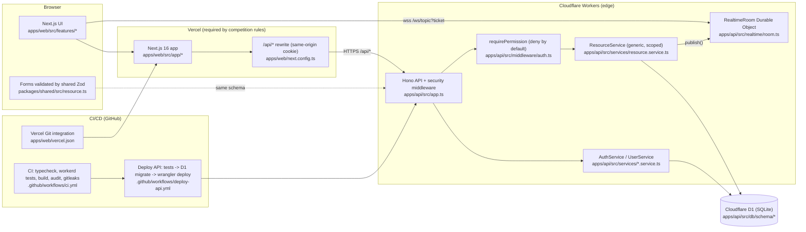
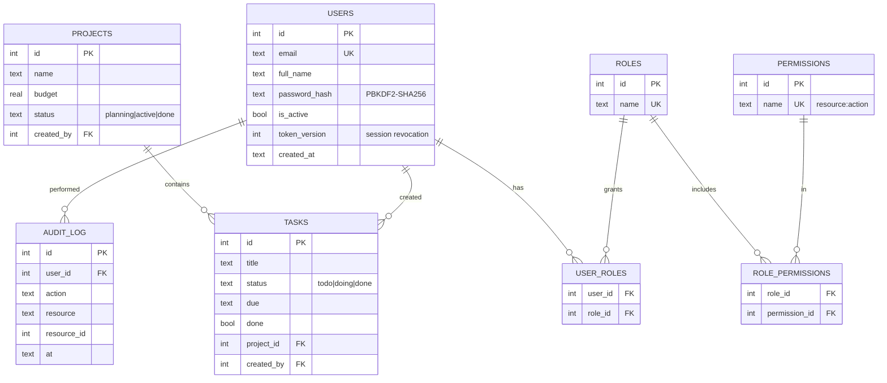

# Architecture Diagrams

Two diagrams: runtime/deploy flow (rarely changes) and the data model (changes every theme as `bun run gen` adds entities). Both exist for the **"Code and design gap - mapping design to code"** rubric line: every node is labeled with the real file that implements it.

GitHub, VS Code and most slide tools render mermaid directly.

## Runtime / deploy flow

## Data model (regenerate every theme)

Core tables from `apps/api/src/db/schema/core.ts`. Add one block per generated resource from `apps/api/src/db/schema/<name>.ts`.

## Checklist before presenting

- [ ] Every node names a real file.
- [ ] The data model shows this theme's entities (drop the practice PROJECTS/TASKS if they were removed with `bun run gen --remove`).
- [ ] Both diagrams render (check in a markdown preview first).
